# Domain User Access Flow (Flipkart)

How `user-access`, `bu-kam-vendor-retailer mapping` and `vendor listing` reach the platform
domain users and sub-entities, what is missing for updates and deletes, and how a person with
both CONTROLLER and KAM access should be handled.

## 1. Current flow

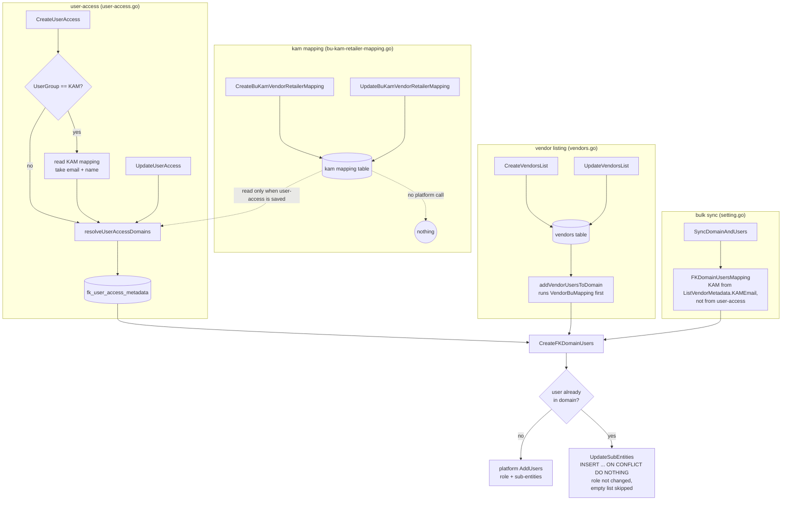

## 2. How `resolveUserAccessDomains` builds the access

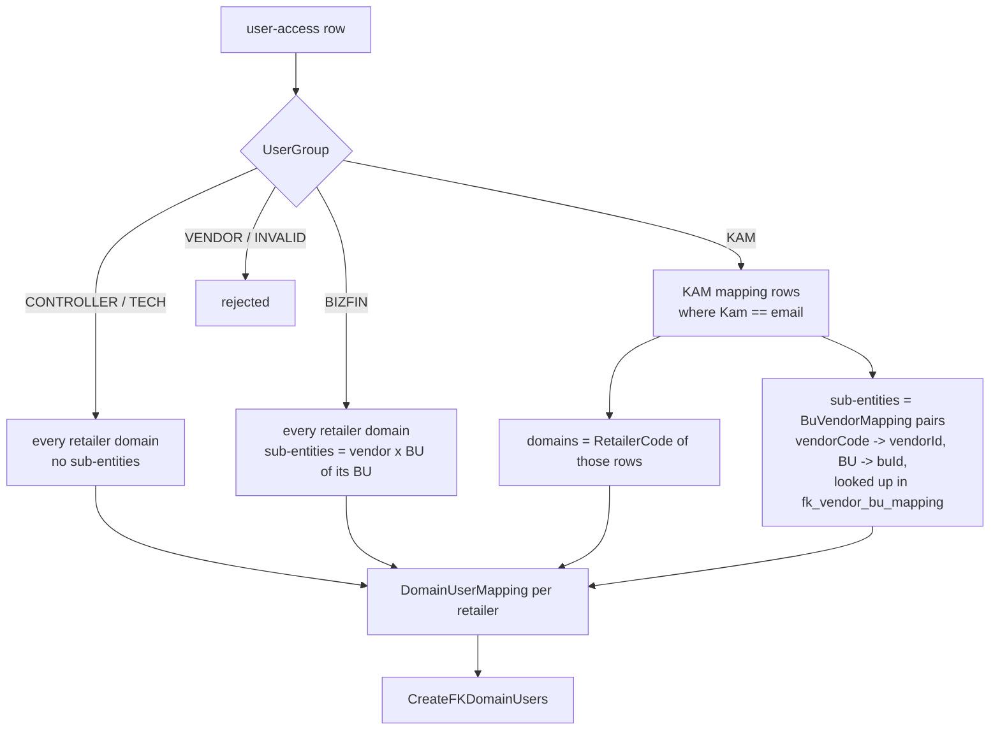

## 3. How access is enforced at request time

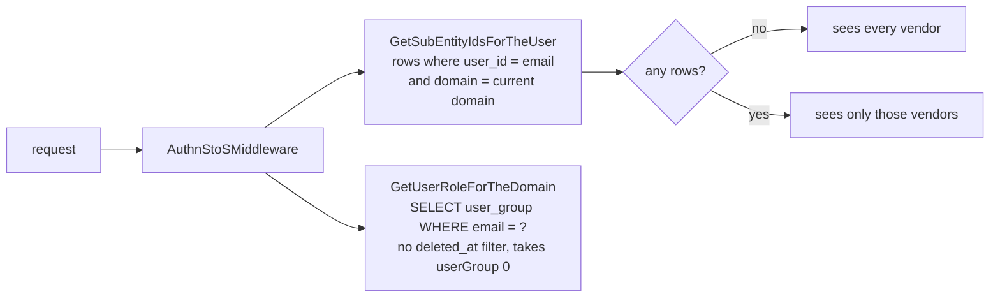

## 4. Gaps on update / delete

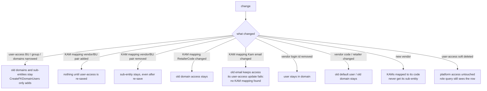

### Why platform `RemoveUsers` cannot be reused

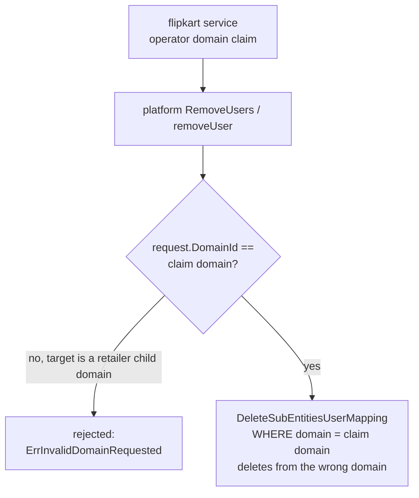

## 5. CONTROLLER + KAM on the same person (today)

Both rows exist because `UniqueId = BU + email + domain` and BU defaults to the user group.

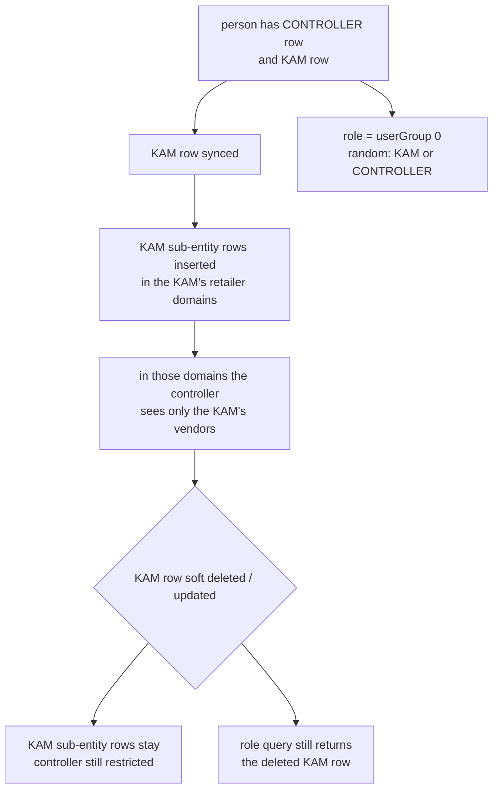

## 6. Proposed flow: sync per person

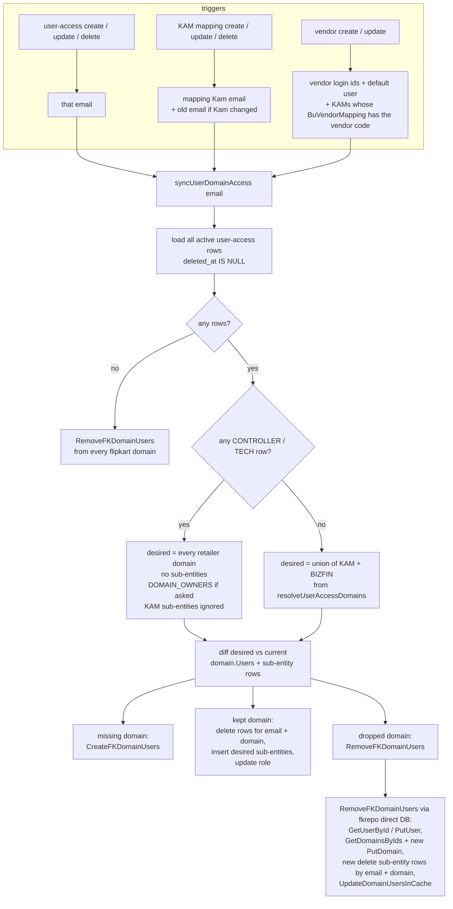

### Example: KAM row of a CONTROLLER soft deleted

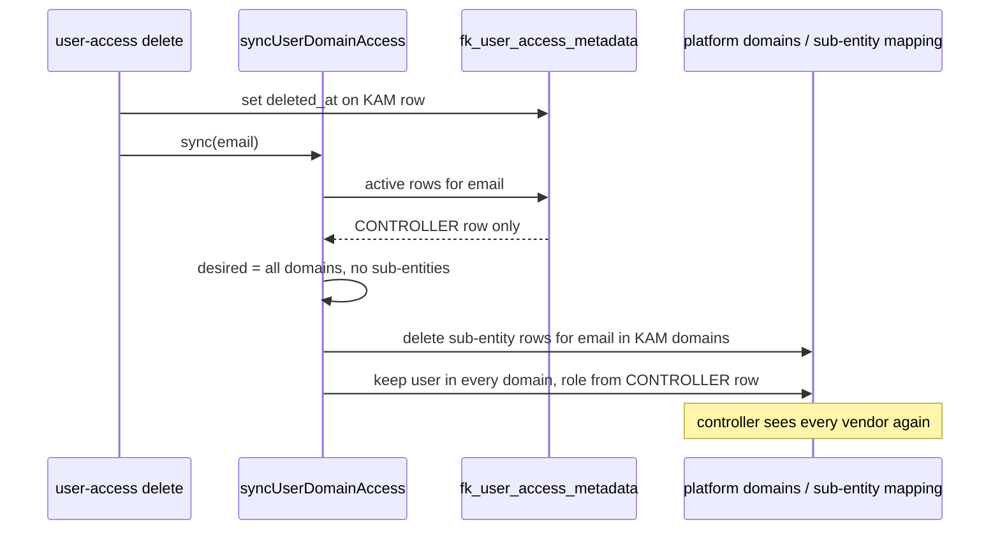

## 7. Per user group (simple version)

Two words used below:
- **Domain** = one retailer (FKI, ANR, ...). Being "in a domain" means the user can open that retailer.
- **Sub-entity** = one vendor x BU pair. If a user has **no** sub-entities in a domain, they see
  **every** vendor there. If they have some, they see **only those**.

### 7.1 CONTROLLER

**What they should get:** every retailer, every vendor. Can be domain owner.

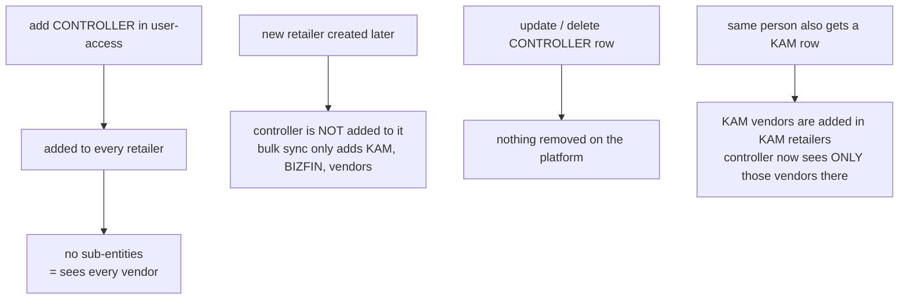

**Problems today**
- Deleting the row does not remove access.
- A new retailer does not get the existing controllers.
- If they also have a KAM row, the KAM vendors limit them (see 5).
- If they were already in a domain, the "domain owner" role is never applied.

**What to do:** run the per-person sync (section 6). If any CONTROLLER row is active, the result is
"every retailer, no sub-entities", whatever other rows say. Also run it for all controllers when a
new retailer domain is created.

### 7.2 KAM

**What they should get:** only the retailers and vendor x BU pairs written in the KAM mapping
for their email.

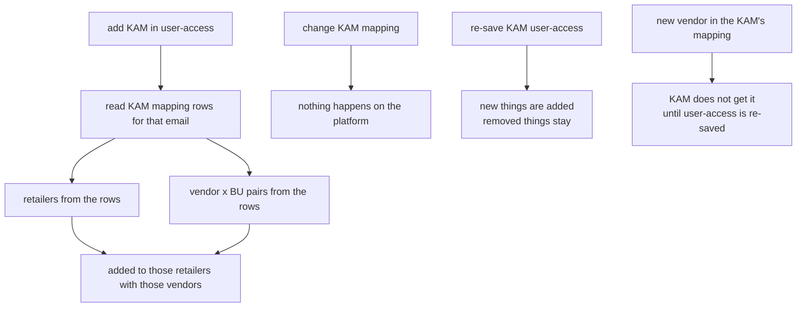

**Problems today**
- Changing the mapping does nothing until someone re-saves the user-access row.
- Even after re-saving, anything removed (vendor, BU, retailer) stays.
- If the mapping's email changes, the old email keeps access, and re-saving its user-access
  row fails with "no KAM mapping found".
- Bulk sync gives KAM access from vendor metadata, not from user-access. So it can give back
  access you removed.

**What to do:** after every KAM mapping save, run the per-person sync for that KAM email (both
emails if it changed). The sync removes what is no longer in the mapping.

### 7.3 VENDOR

Vendors are **not** in user-access. User-access rejects the VENDOR group. Vendor users come from
the vendor list: `<vendorCode>@vapusdata.com` plus every login ID.

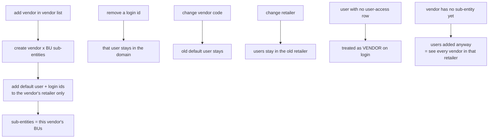

**Problems today**
- Nothing is ever removed: old login IDs, the old default user, and the old retailer all stay.
- A vendor without sub-entities is added with no sub-entities, so its users see **all** vendors in
  that retailer. This is a security risk.

**What to do:** on vendor update, compare old and new login IDs, vendor code and retailer, and
remove the old users (`RemoveFKDomainUsers`). Do not add vendor users until their sub-entities
exist. After a vendor change, also run the KAM sync for KAMs whose mapping lists this vendor code.

### 7.4 BIZFIN

**What they should get:** every retailer, but only the vendors in their own BU.

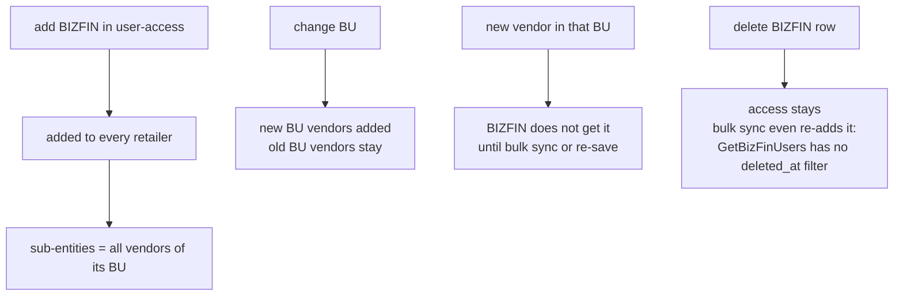

**What to do:** the same per-person sync. Also add `deleted_at IS NULL` to `GetBizFinUsers`. After a
new vendor x BU sub-entity is created, run the sync for the BIZFIN users of that BU.

### 7.5 TECH

**What they should get:** every retailer, every vendor, **read only**. Never a domain owner.

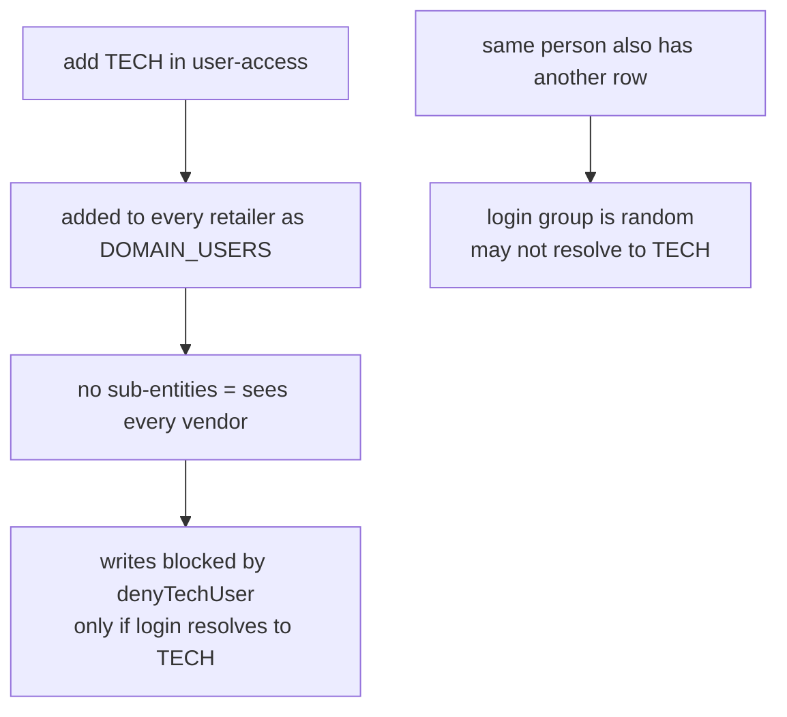

**Problems today**
- Same as CONTROLLER: nothing is removed, and a new retailer does not get them.
- Read-only works only if login picks the TECH row.

**What to do:** the same per-person sync. Fix the login query so the group is picked by priority,
not at random.

### 7.6 One person, many groups

| Rows the person has | What they should get |
|---|---|
| CONTROLLER + anything | every retailer, every vendor (CONTROLLER wins) |
| TECH + KAM / BIZFIN | every retailer, every vendor, read only (TECH wins) |
| BIZFIN + KAM | every retailer: own-BU vendors **plus** KAM vendors in the KAM retailers |
| KAM only | KAM retailers, KAM vendors only |
| one row deleted | re-run the sync on the rows left, e.g. KAM deleted from CONTROLLER + KAM gives full access back |
| all rows deleted | removed from every retailer |

Rule: **access is worked out from all active rows of one person together, never from one row alone.**

## 8. Related fixes

- `GetUserRoleForTheDomain` (`internals/app/datarepo/domain.go`): add `deleted_at IS NULL`, pick by
  priority CONTROLLER > TECH > BIZFIN > KAM instead of `userGroup[0]`.
- `DeleteSubEntitiesUserMapping` (`app/platform/datastoreops/subentity-user-mapping.go`): deletes by the
  claim domain, not the target domain.
- `FKDomainUsersMapping` bulk sync builds KAM access from vendor metadata, not user-access, so it can
  give back access that user-access removed. Either route it through user-access or skip KAMs without
  an active user-access row.
