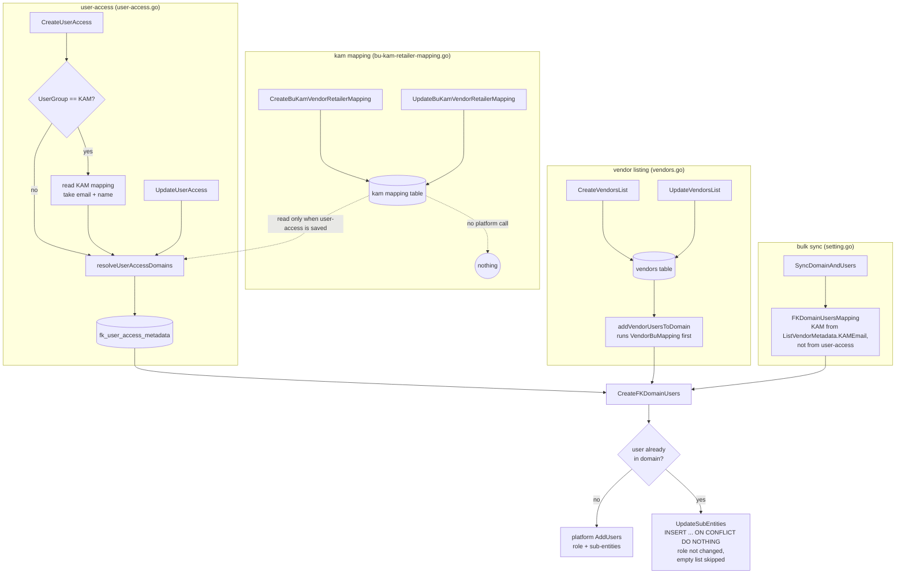
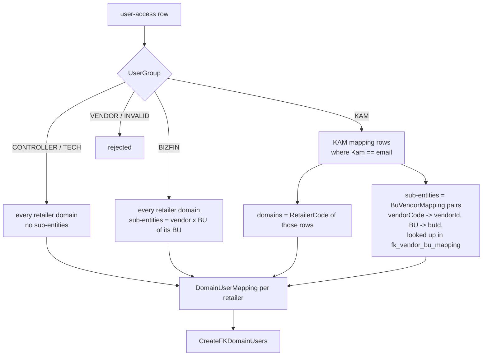
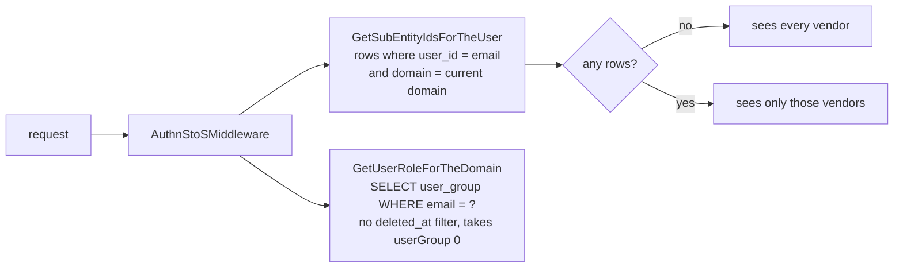
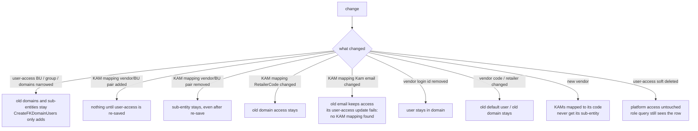
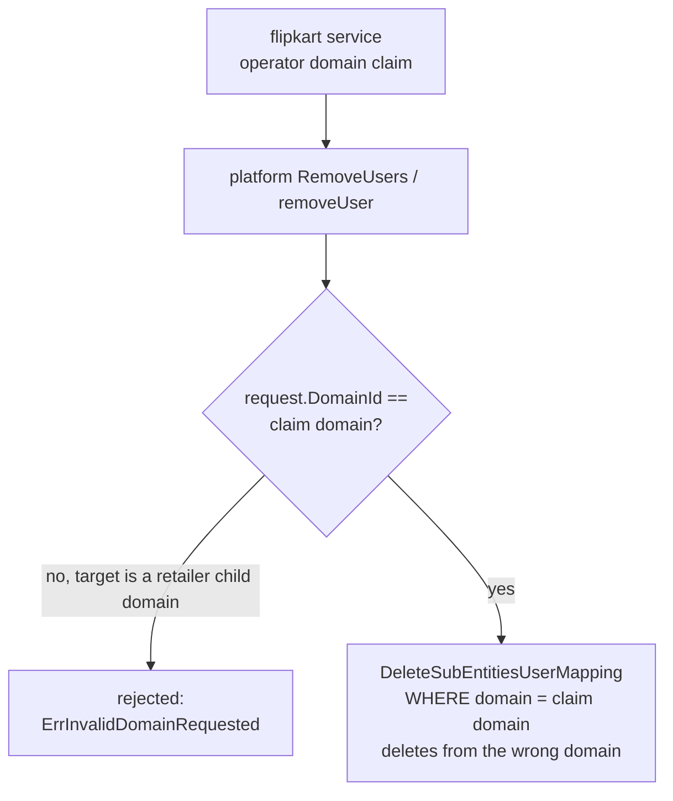
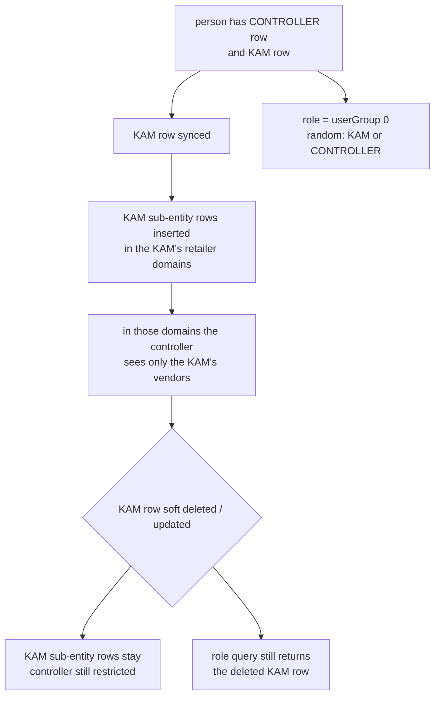
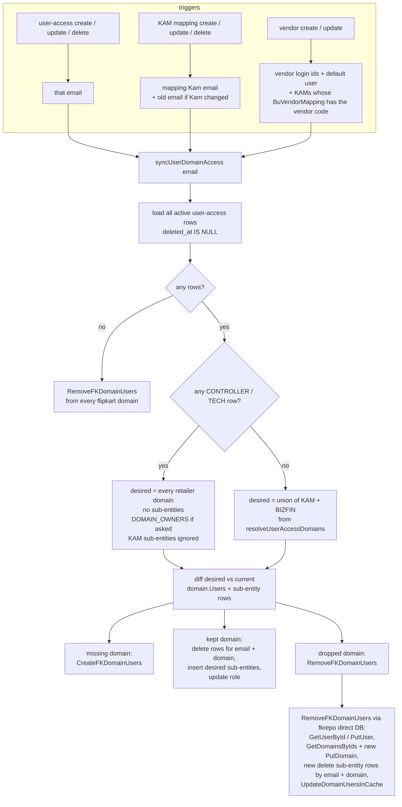
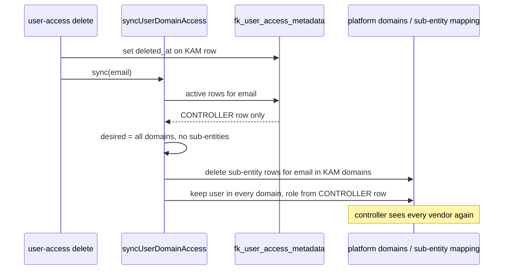

# Domain User Access Flow (Flipkart)

How `user-access`, `bu-kam-vendor-retailer mapping` and `vendor listing` reach the platform
domain users and sub-entities, what is missing for updates and deletes, and how a person with
both CONTROLLER and KAM access should be handled.

## 1. Current flow

## 2. How `resolveUserAccessDomains` builds the access

## 3. How access is enforced at request time

## 4. Gaps on update / delete

### Why platform `RemoveUsers` cannot be reused

## 5. CONTROLLER + KAM on the same person (today)

Both rows exist because `UniqueId = BU + email + domain` and BU defaults to the user group.

## 6. Proposed flow: sync per person

### Example: KAM row of a CONTROLLER soft deleted

## 7. Related fixes

- `GetUserRoleForTheDomain` (`internals/app/datarepo/domain.go`): add `deleted_at IS NULL`, pick by
  priority CONTROLLER > TECH > BIZFIN > KAM instead of `userGroup[0]`.
- `DeleteSubEntitiesUserMapping` (`app/platform/datastoreops/subentity-user-mapping.go`): deletes by the
  claim domain, not the target domain.
- `FKDomainUsersMapping` bulk sync builds KAM access from vendor metadata, not user-access, so it can
  give back access that user-access removed. Either route it through user-access or skip KAMs without
  an active user-access row.
