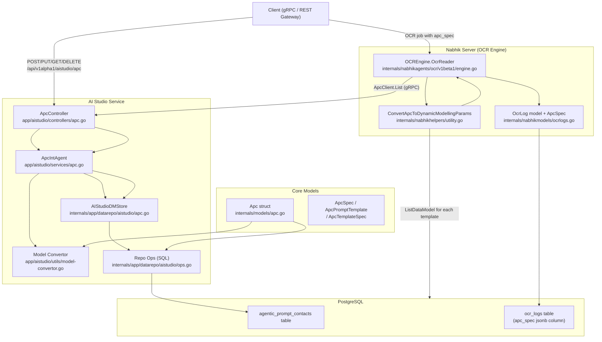
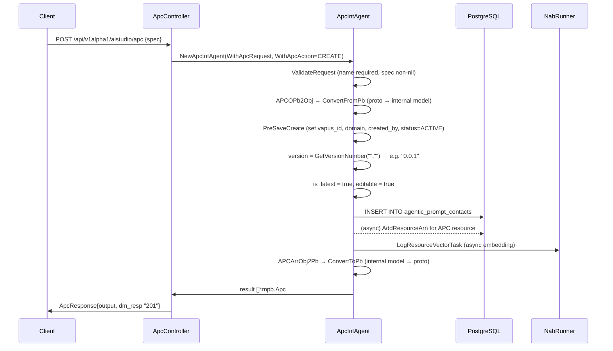
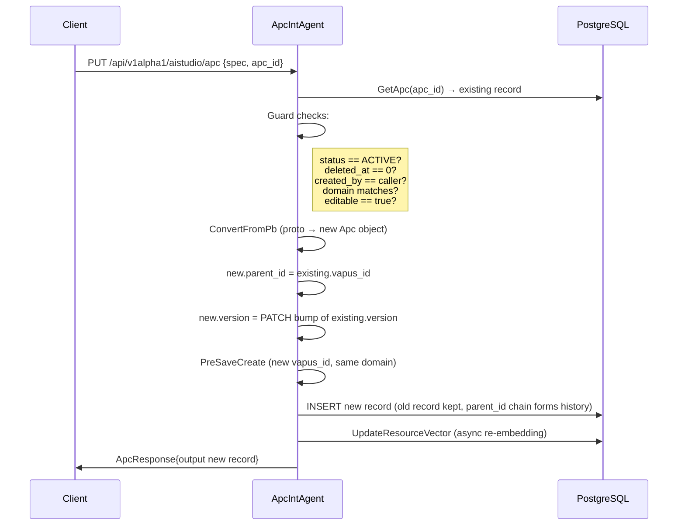
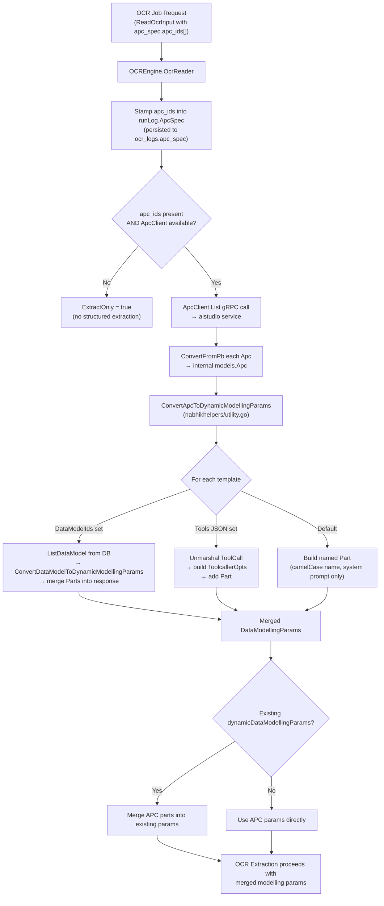
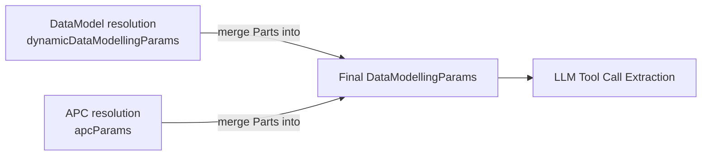
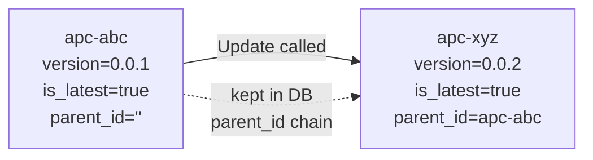

# Agentic Prompt Contracts (APC) — Architecture

> **Branch:** `VGP-3762`  
> **Scope:** APC lifecycle (CRUD) + APC-driven OCR data modelling  
> **Services touched:** `aistudio`, `nabhikserver` (OCR engine)

---

## 1. What is an APC?

An **Agentic Prompt Contract** (APC) is a versioned, domain-scoped configuration object that packages:

- A **system message** (base LLM instruction)
- An optional **user message** (context or question)
- One or more **named templates**, each of which resolves to either:
  - A set of `DataModel` IDs (structured extraction schemas fetched at runtime)
  - A raw `ToolCall` JSON definition (inline function schema)
  - A default named part (minimal toolcall with camelCased name)

APCs are the reusable unit of "what should the OCR engine extract and how". They decouple the extraction instruction from the OCR job submission, letting the same contract be referenced across multiple OCR runs.

---

## 2. High-Level Architecture



---

## 3. Data Model Layers

### 3.1 Proto Contract — `apis/protos/models/v1alpha1/apc.proto`

This is the **wire format** — what clients send and receive over gRPC/REST.

```
Apc
├── api_version       string
├── type              string
├── parent_id         string           ← set on Update to point to previous version
├── metadata          PromptMetadata
│   ├── name          string           ← unique identifier within domain
│   ├── editable      bool
│   ├── is_json_prompt bool
│   └── resource_base VapusBase        ← vapus_id, domain, created_by, status, etc.
└── spec              ApcPromptSpec
    ├── system_message string          ← base LLM instruction for all templates
    ├── user_message   string          ← optional user-side context
    ├── versions       PromptVersions  ← is_latest + available[]
    ├── annotations    PromptAnnotations ← version string (semver)
    ├── metadata       PromptResourceMetadata ← labels[], tags[], end_tags[]
    ├── samples[]      Sample          ← input/output examples
    └── templates[]    PromptTemplate
        ├── name       string          ← unique key for this extraction part
        └── spec       TemplateSpec
            ├── system_message string ← overrides parent system_message if set
            ├── data_model_ids[]  string  ← IDs of DataModel records to resolve
            └── tools     ToolCall    ← inline function schema (alt to data_model_ids)
```

**Service contract — `apis/protos/vapusai-studio/v1alpha1/apc.proto`**

| RPC | HTTP | Request | Response |
|-----|------|---------|----------|
| `Create` | `POST /api/v1alpha1/aistudio/apc` | `ApcRequest{spec}` | `ApcResponse{output[], dm_resp}` |
| `Update` | `PUT /api/v1alpha1/aistudio/apc` | `ApcRequest{spec, apc_id}` | `ApcResponse{output[], dm_resp}` |
| `Get` | `GET /api/v1alpha1/aistudio/apc/{apc_id}` | `ApcGetterRequest{apc_id}` | `ApcResponse{output[], dm_resp}` |
| `List` | `GET /api/v1alpha1/aistudio/apc` | `ApcGetterRequest{apc_ids[]}` | `ApcResponse{output[], dm_resp}` |
| `Archive` | `DELETE /api/v1alpha1/aistudio/apc/{apc_id}` | `ApcGetterRequest{apc_id}` | `ApcResponse{dm_resp}` |

---

### 3.2 Internal Model — `internals/models/apc.go`

The **DB-mapped struct** stored in PostgreSQL table `agentic_prompt_contacts`.

| Column | Type | Notes |
|--------|------|-------|
| `vapus_id` | `string` (indexed) | System-assigned unique ID |
| `name` | `string UNIQUE` | Human name, must be unique per account |
| `type` | `string` | Free-form type tag |
| `editable` | `bool` | Guards update permission |
| `is_json_prompt` | `bool` | Hint for downstream rendering |
| `is_latest` | `bool` | Latest version flag; older versions keep `false` |
| `system_message` | `text` | Top-level LLM system prompt |
| `user_message` | `text` | Top-level user prompt |
| `version` | `string` | Semver, auto-incremented on update |
| `parent_id` | `string` | Points to previous version's `vapus_id` |
| `labels` | `text[]` | Postgres array, GIN indexed |
| `tags` | `text[]` | Postgres array, GIN indexed |
| `end_tags` | `text[]` | Postgres array |
| `spec` | `jsonb` | `ApcSpec` — templates, samples, version history |

**`ApcSpec` (JSONB)**

```
ApcSpec
├── available_versions []string
├── deprecated_versions []string
├── samples[]
│   ├── input_text  string
│   └── response    string
└── templates[]          ← ApcPromptTemplate
    ├── name  string
    └── spec  ApcTemplateSpec
        ├── system_message  string
        ├── data_model_ids  []string
        └── tools           string   ← JSON-encoded ToolCall proto
```

Templates and their specs are stored **entirely inside the `spec` JSONB column** — they are not separate rows. This keeps the APC as a single atomic record while still allowing rich nested structure.

**DB Indexes created by `AfterCreateTable`**

- Unique index on `vapus_id`
- BTree on `created_at`, `updated_at`, `name`, `vapus_id`
- Compound BTree on `(domain, owner_account)` and `owner_account`
- GIN on `labels` and `tags` for array containment queries

---

### 3.3 OCR Integration Models — `internals/nabhikmodels/ocrlogs.go`

Two lightweight structs that attach APC identity to OCR run records:

```
PromptSpec
└── prompt_ids  []string    ← stored as JSONB in ocr_logs.prompt_spec

ApcSpec
└── apc_ids     []string    ← stored as JSONB in ocr_logs.apc_spec
```

`OcrLog` gains two new JSONB columns:

| Column | Type | Purpose |
|--------|------|---------|
| `prompt_spec` | `jsonb` | Which prompt IDs guided this run |
| `apc_spec` | `jsonb` | Which APC IDs drove data modelling for this run |

These are **audit columns** — they record what contract was active at the time of the OCR job, independent of whether the APC is later updated or archived.

---

## 4. CRUD Flow

### 4.1 Create



**Key detail — versioning on Create:**  
A fresh Create always starts at a system-generated version (e.g. `0.0.1`), sets `is_latest = true`, and records the version in `spec.available_versions`.

---

### 4.2 Update



**Key detail — immutable versioning:**  
Update does **not** mutate the existing row. It inserts a **new record** with a fresh `vapus_id` and increments the patch version. The old record is preserved with its original `vapus_id`, enabling full audit history via the `parent_id` chain.

---

### 4.3 Get / List

- **Get**: fetches a single record by `vapus_id` with account-scoped filter. Calls `ConvertToPb()` (full detail including templates).
- **List**: if `apc_ids[]` is provided in the request, filters to those IDs. Otherwise returns all active APCs for the domain. Calls `ConvertToPb()` for each. The `List` endpoint is also called internally by the OCR engine (see §5).

---

### 4.4 Archive

Soft-delete: fetches the record, sets `status = DELETED`, calls `PreSaveDelete` (stamps `deleted_at`), then `UPDATE`s the row. The record remains in the table but is excluded from all active queries.

---

## 5. APC-Driven OCR Data Modelling

### 5.1 Overview

When submitting an OCR job, the caller can include `apc_spec.apc_ids[]` in the request. The OCR engine uses these to resolve what data structure to extract — replacing or supplementing the older `data_model_ids[]` approach.



### 5.2 `ConvertApcToDynamicModellingParams` — `internals/nabhikhelpers/utility.go`

This is the **bridge function** between the APC contract and the OCR engine's internal extraction model. It is the central piece of the APC × OCR integration.

**Inputs:**
- `apcs []*models.Apc` — internal APC objects (already fetched from aistudio)
- `store *apppkgs.VapusStore` — direct DB access for resolving `DataModelIds`
- `ctxClaim` — auth claim for governance-scoped DB queries

**What it builds — `DataModellingParams`:**

```
DataModellingParams
├── BaseOcrPrompt   string              ← from first non-empty APC.SystemMessage
├── CustomPrompts   []string            ← accumulated APC.UserMessage values
├── ColumnsMaster   []string            ← column headers from resolved DataModels
├── MasterDataModel map[string]any      ← schema objects keyed by DataModel name
└── Parts           map[string]*DataModellingPart
    └── key = template.Name
        └── DataModellingPart
            ├── FullPath        string
            └── ToolcallerOpts  ToolCall
                ├── Name          string
                ├── Description   string
                ├── SystemPrompt  string  ← template or APC system_message
                └── InputSchema   *StructpbValue  ← JSON Schema for LLM tool call
```

**Template resolution priority (per template):**

| Condition | Resolution path |
|-----------|----------------|
| `data_model_ids` non-empty | Fetch `DataModel` rows from DB → `ConvertDataModelToDynamicModellingParams` → merge parts + schemas |
| `tools` JSON non-empty and non-`"null"` | Unmarshal `ToolCall` proto → build `ToolcallerOpts` directly |
| Neither | Create a named Part with camelCased template name and system prompt only |

**System message inheritance:**  
Each template inherits its `system_message` from itself. If the template's own `system_message` is empty, it falls back to the parent APC's `system_message`. This allows a single APC-level instruction to govern all templates while still supporting per-template overrides.

---

### 5.3 Merge Behaviour in the Engine

When both `DataModelIds` and `ApcIds` are present in the same OCR request, the engine runs both resolution paths and **merges** the resulting `Parts` maps. APC parts use `key = tmpl.Name`; DataModel parts use `key = dm.Name`. There is no collision as long as names are distinct.



---

## 6. File Map

| File | Layer | Role |
|------|-------|------|
| `apis/protos/models/v1alpha1/apc.proto` | Wire contract | `Apc`, `ApcPromptSpec`, `PromptTemplate`, `TemplateSpec`, `ApcSpec` message definitions |
| `apis/protos/vapusai-studio/v1alpha1/apc.proto` | Service contract | `ApcService` RPC definitions + HTTP bindings |
| `apis/protos/vapustools/v1beta1/ocr.proto` | Wire contract | `ApcSpec`, `PromptSpec` fields on `OcrRequest` and `OcrLog` |
| `internals/models/apc.go` | Core model | `Apc`, `ApcSpec`, `ApcSample`, `ApcPromptTemplate`, `ApcTemplateSpec` + `ConvertFromPb`/`ConvertToPb`/`ConvertToListingPb` |
| `internals/nabhikmodels/ocrlogs.go` | OCR model | `ApcSpec` + `PromptSpec` structs; `OcrLog.ApcSpec` field; `ConvertToPbForApcSpec()` |
| `internals/app/datarepo/aistudio/ops.go` | Repo (SQL) | `CreateApc`, `ListApc`, `GetApc`, `UpdateApc` — raw SQL + bun ORM queries |
| `internals/app/datarepo/aistudio/apc.go` | Repo interface | `AIStudioDMStore` method wrappers delegating to `ops.go` |
| `internals/app/pkgs/vapusdb-constants.go` | Config | `AgenticPromptContractsTable = "agentic_prompt_contacts"` |
| `internals/app/errors/aistudio.go` | Errors | `ErrAPC404`, `ErrInvalidAPCRequestSpec`, `ErrAPCNameRequired`, `ErrSavingAPC` |
| `app/aistudio/services/apc.go` | Service agent | `ApcIntAgent` — all business logic for create/update/get/list/archive |
| `app/aistudio/controllers/apc.go` | gRPC controller | Thin dispatch layer; calls `NewApcIntAgent` + `Act` |
| `app/aistudio/utils/model-convertor.go` | Conversion utils | `APCOPb2Obj`, `APCArrObj2Pb`, `APCListObj2Pb`, `APCPb2Obj` |
| `app/aistudio/server/server.go` | Server bootstrap | `pb.RegisterApcServiceServer(...)` |
| `internals/app/grpcclients/svcclients.go` | gRPC client | `ApcClient aipb.ApcServiceClient` registered at client init |
| `internals/nabhikhelpers/utility.go` | OCR helper | `ConvertApcToDynamicModellingParams` — resolves APC templates into extraction params |
| `internals/nabhikagents/ocr/v1beta1/engine.go` | OCR engine | Consumes `ApcClient.List`, calls `ConvertApcToDynamicModellingParams`, merges into OCR run |
| `app/operator/migrations/nabhik/1782121416_...` | Migration | Adds `apc_spec jsonb` column to `ocr_logs` |

---

## 7. API Testing Guide

### 7.1 Create an APC

**Endpoint:** `POST /api/v1alpha1/aistudio/apc`

**Minimum payload:**

```json
{
  "spec": {
    "metadata": {
      "name": "invoice-extractor-v1",
      "editable": true,
      "isJsonPrompt": false
    },
    "spec": {
      "systemMessage": "You are an invoice extraction assistant. Extract structured data from the provided document.",
      "userMessage": "Extract all invoice fields.",
      "templates": [
        {
          "name": "invoice-header",
          "spec": {
            "systemMessage": "Focus on header fields: invoice number, date, vendor name.",
            "dataModelIds": ["<data-model-vapus-id>"]
          }
        }
      ]
    }
  }
}
```

**Using inline tool instead of dataModelIds:**

```json
{
  "spec": {
    "metadata": {
      "name": "invoice-extractor-tool-v1",
      "editable": true
    },
    "spec": {
      "systemMessage": "Extract structured invoice data.",
      "templates": [
        {
          "name": "invoice-line-items",
          "spec": {
            "tools": {
              "functionSchema": {
                "name": "extractLineItems",
                "description": "Extract all line items from the invoice",
                "parameters": {
                  "type": "object",
                  "properties": {
                    "items": {
                      "type": "array",
                      "items": {
                        "type": "object",
                        "properties": {
                          "description": { "type": "string" },
                          "amount": { "type": "number" }
                        }
                      }
                    }
                  }
                }
              }
            }
          }
        }
      ]
    }
  }
}
```

**Expected response schema:**

```json
{
  "dmResp": {
    "status": "201",
    "message": "APC created successfully",
    "requestId": "..."
  },
  "output": [
    {
      "type": "",
      "metadata": {
        "name": "invoice-extractor-v1",
        "editable": true,
        "isJsonPrompt": false,
        "resourceBase": {
          "vapusId": "apc-<generated-id>",
          "createdBy": "<user-id>",
          "createdAt": 1700000000,
          "status": "ACTIVE",
          "domain": "<domain-id>",
          "ownerAccount": "<account-id>"
        }
      },
      "spec": {
        "systemMessage": "You are an invoice extraction assistant...",
        "userMessage": "Extract all invoice fields.",
        "versions": { "isLatest": true },
        "annotations": { "version": "0.0.1" },
        "metadata": { "labels": [], "tags": [] },
        "templates": [...]
      }
    }
  ]
}
```

---

### 7.2 Update an APC

**Endpoint:** `PUT /api/v1alpha1/aistudio/apc`

```json
{
  "apcId": "apc-<existing-vapus-id>",
  "spec": {
    "metadata": {
      "name": "invoice-extractor-v1",
      "editable": true
    },
    "spec": {
      "systemMessage": "Updated system message.",
      "templates": [...]
    }
  }
}
```

> Update creates a **new record** with a new `vapus_id` and `version = PATCH+1`. The original record is preserved. `parent_id` on the new record points to the old `vapus_id`.

---

### 7.3 Get a Single APC

**Endpoint:** `GET /api/v1alpha1/aistudio/apc/{apc_id}`

No body required. Returns full APC including all templates and samples.

---

### 7.4 List APCs

**Endpoint:** `GET /api/v1alpha1/aistudio/apc`

- No query params → returns all active APCs in the caller's domain
- `?apc_ids=id1,id2` → returns only those APCs (used internally by OCR engine)

---

### 7.5 Archive an APC

**Endpoint:** `DELETE /api/v1alpha1/aistudio/apc/{apc_id}`

No body. Soft-deletes: sets `status = DELETED`, stamps `deleted_at`. The record is not physically removed.

---

### 7.6 Submit an OCR Job with APC

**Endpoint:** `POST /api/v1beta1/nabhikserver/ocr` (or the equivalent OCR submission endpoint)

The `apc_spec` field replaces or supplements the `data_model_ids` field in the OCR request:

```json
{
  "taskId": "task-<id>",
  "input": {
    "files": [{ "path": "gs://bucket/invoice.pdf" }]
  },
  "apcSpec": {
    "apcIds": ["apc-<vapus-id-1>", "apc-<vapus-id-2>"]
  }
}
```

**What happens at runtime:**
1. OCR engine stamps `apc_ids` into `ocr_logs.apc_spec` for the run record.
2. It calls `aistudio.ApcClient.List(apcIds)` over internal gRPC.
3. Each APC's templates are resolved to `DataModellingParts`.
4. The LLM uses the resulting tool schemas to extract structured data from the document.
5. The `ocr_logs` row (and its child `ocr_docs` rows) carry the resolved output.

**Minimum OCR request with only APC (no DataModelIds):**
If `apc_spec.apc_ids` is provided but `data_model_ids` is empty and `dynamic_data_modelling_params` is nil, the engine proceeds with APC-derived params alone. If all three are absent, the engine falls back to `ExtractOnly = true` (raw text extraction, no structured output).

---

## 8. Versioning Strategy



- Every `Update` **inserts** a new row rather than mutating the old one.
- `parent_id` forms a linked list of APC history.
- The caller must use the **new** `vapus_id` from the response for subsequent references.
- There is currently no automatic `is_latest = false` back-fill on the old record — consumers should rely on the `parent_id` chain or the returned `vapus_id` from the update response to track which is current.

---

## 9. Error Reference

| Error sentinel | Trigger |
|---------------|---------|
| `ErrAPCNameRequired` | `Create` called without `metadata.name` |
| `ErrInvalidAPCRequestSpec` | `spec` is nil or `ConvertFromPb` returns nil |
| `ErrAPC404` | `Get`/`Update`/`Archive` — record not found or empty ID |
| `ErrSavingAPC` | DB insert/update failed |
| `ErrResourceNotActive` | `Update` on an archived APC |
| `ErrAIPromptNotEditable` | `Update` on an APC with `editable = false` |
| `ErrPrompt403` | `Update` caller is not the original creator or wrong domain |
