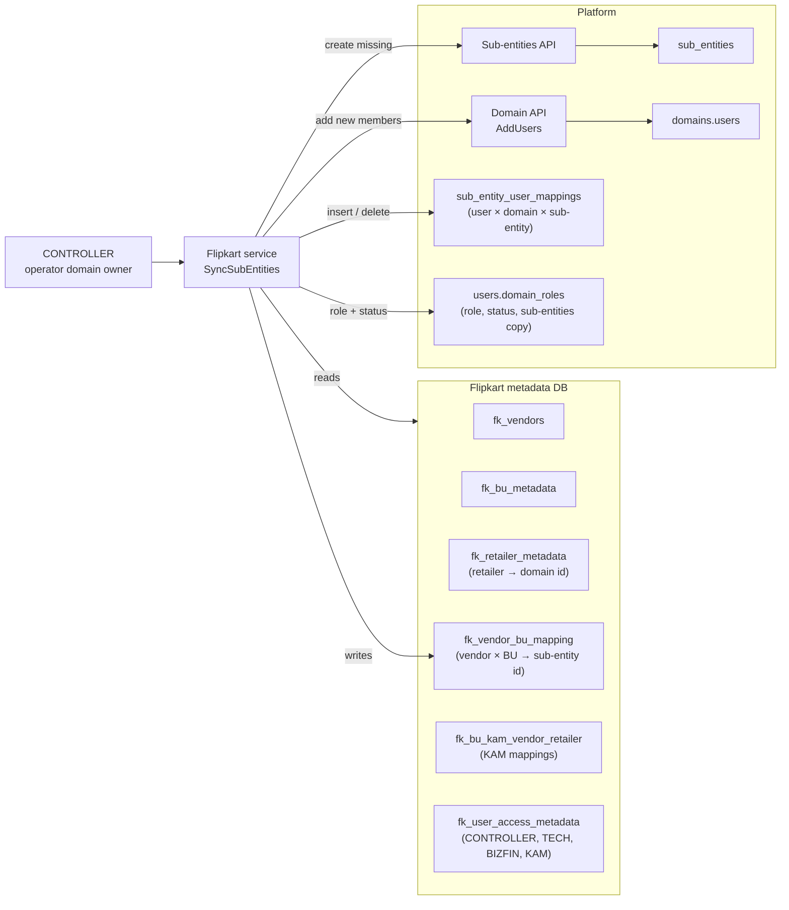
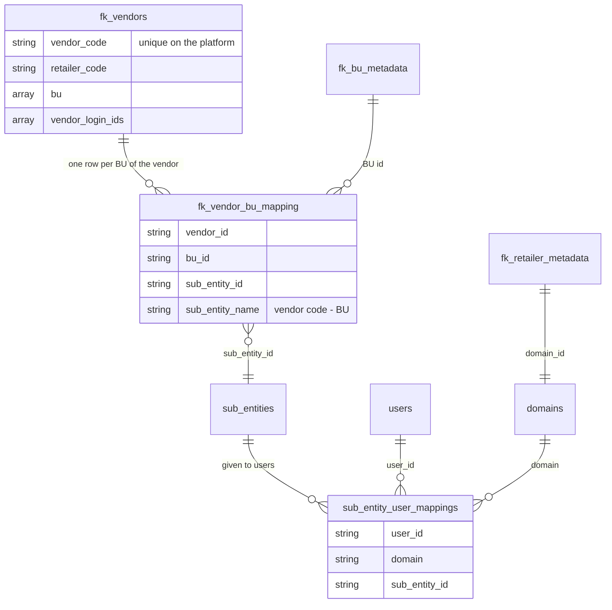
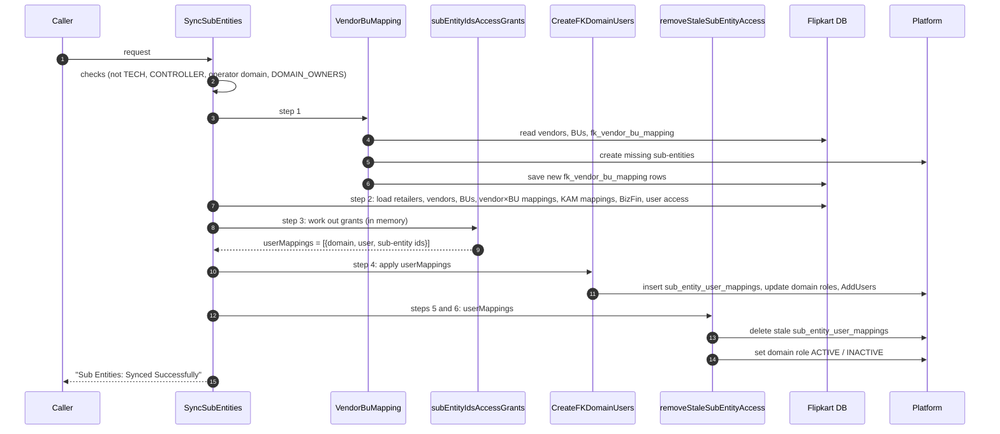
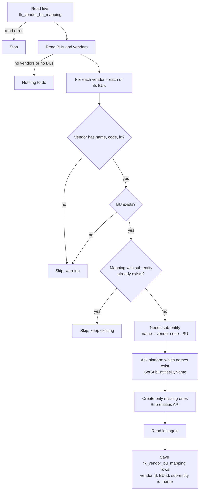
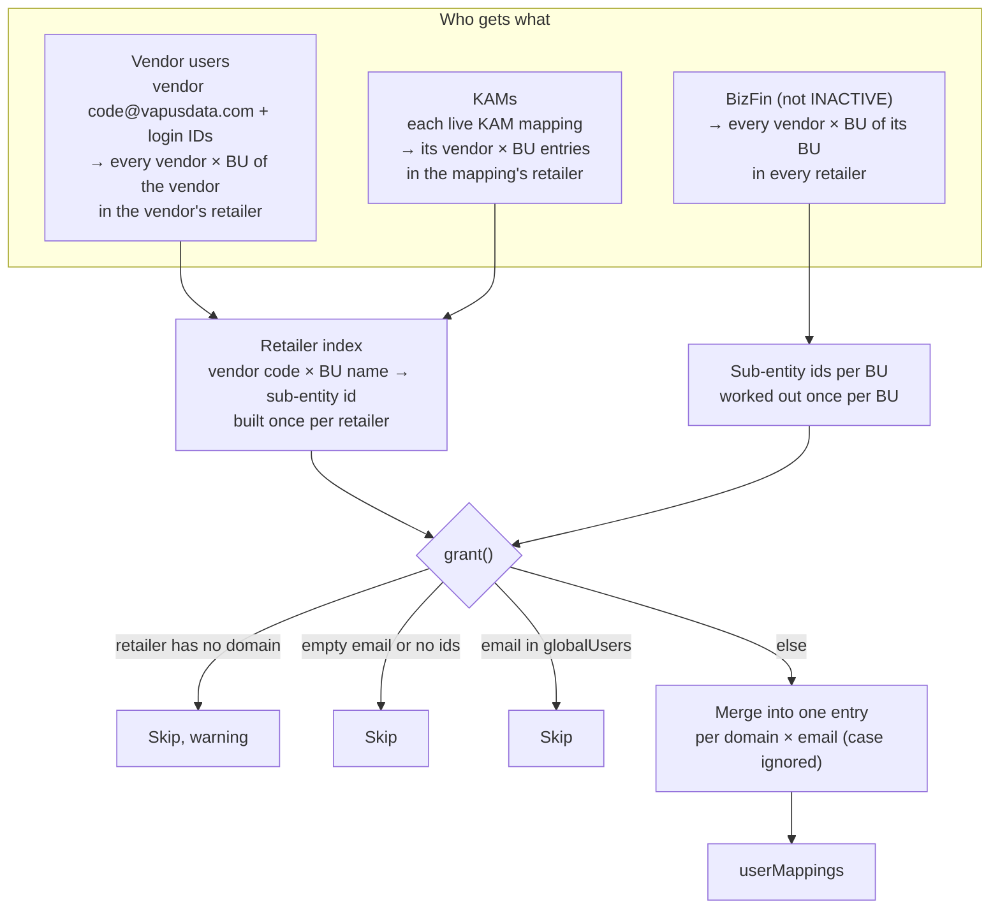
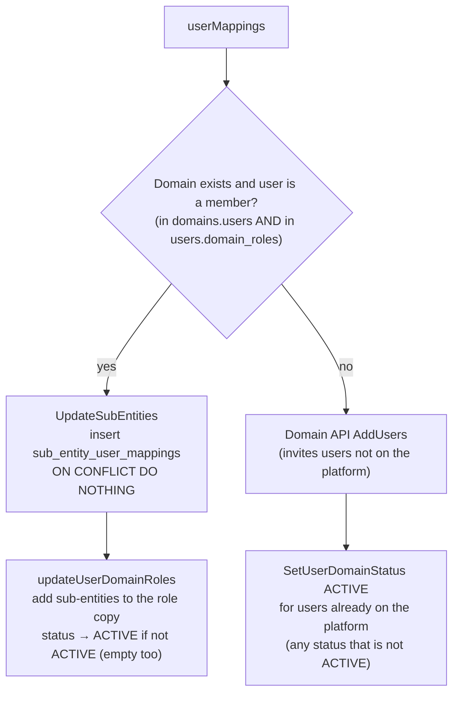
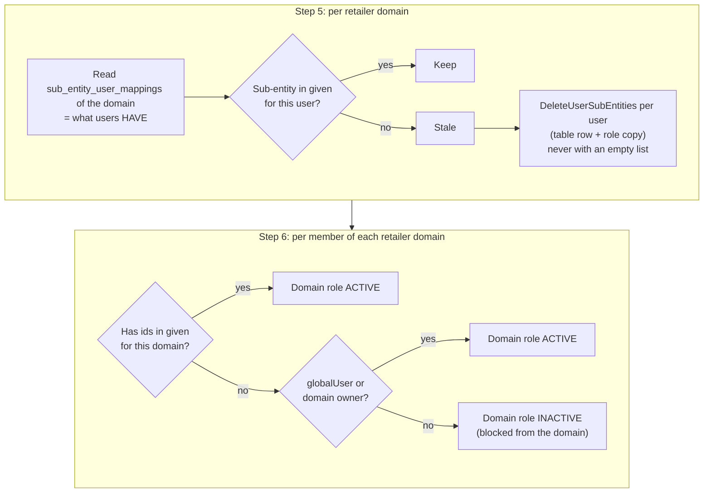

# Sub-entities Sync — Technical Guide

- Backend: `SyncSubEntities` in [services/setting.go](../services/setting.go)
- Tests: `TestSubEntityAccessGrants`, `TestRemoveStaleSubEntityAccess` in [setting_sync_test.go](../services/setting_sync_test.go), `TestSyncSubEntitiesRejectsRequest` in [setting_test.go](../services/setting_test.go)
- Related: [SUB_ENTITY_AND_DOMAIN_TECHNICAL.md](SUB_ENTITY_AND_DOMAIN_TECHNICAL.md) (section 14), [VENDOR_LIST_FLOW.md](VENDOR_LIST_FLOW.md), [KAM_MAPPING_FLOW.md](KAM_MAPPING_FLOW.md), [USER_ACCESS_FLOW.md](USER_ACCESS_FLOW.md)
- API: `POST /customsvc/flipkart/api/v1/sync-sub-entities` (`SyncSubEntities` RPC in `setting.proto`, controller in [controllers/setting.go](../controllers/setting.go))

## 1. What it does

Every retailer is a domain on the platform. Inside a domain, a user sees only the vendors of the **sub-entities** given to them. One sub-entity = one vendor × BU.

**A user with no sub-entity sees every vendor in the domain.** So access must be exact.

Access normally changes one screen action at a time (vendor, KAM mapping, user access). If an action fails half way, or data is loaded straight into the tables, users end up with wrong access. The sync rebuilds everyone's access from the metadata tables and makes the platform match:

1. Every vendor × BU has a sub-entity.
2. Every user has exactly the sub-entities the rules give.
3. Sub-entities the rules no longer give are removed.
4. A user left with no sub-entity in a domain is set INACTIVE there.

Running it again changes nothing.

## 2. Architecture



What decides access:

| Table | Holds | Who writes it in the sync |
|---|---|---|
| `fk_vendor_bu_mapping` | vendor id × BU id → sub-entity id | step 1 |
| `sub_entities` (platform) | the sub-entity itself, unique by name + domain | step 1, through the Sub-entities API |
| `sub_entity_user_mappings` (platform) | which user has which sub-entity in which domain. **This decides access.** | step 4 (add), step 5 (remove) |
| `users.domain_roles` (platform) | the user's role and status per domain, plus a copy of its sub-entities | steps 4 and 6 |
| `domains.users` (platform) | members of the domain | step 4 (new members) |

## 3. Data model



## 4. End-to-end flow



## 5. Step 0 — Who can call

Checked in order. The first failure is returned. Nothing runs.

| Check | Fails → |
|---|---|
| Claim in context | invalid JWT claims |
| User is not TECH (`denyTechUser`) | `PermissionDenied`: *TECH users have read-only access* |
| User group is CONTROLLER | `PermissionDenied`: *only CONTROLLER users can sync sub-entities* |
| Domain is the operator domain | *invalid domain type for sub-entities sync* |
| Domain role is DOMAIN_OWNERS | *invalid role for sub-entities sync* |

The sync sees and changes every retailer domain, so it runs only from the operator domain. A CONTROLLER never gets sub-entities, so the sync never takes away the caller's own access.

## 6. Step 1 — Create missing sub-entities (`VendorBuMapping`)



- Name: `<vendor code>-<BU>`, for example `VEN123-Mobile`. Display name: `<vendor name>-<BU display name>`.
- A vendor code is unique on the platform, so every vendor × BU gets its own sub-entity.
- Existing pairs are matched by vendor id × BU id, not by name. They keep their sub-entity.
- The platform insert is `ON CONFLICT DO NOTHING` on name + domain. A sub-entity left by an earlier failed run is used again, not created twice.

## 7. Step 2 — Load data

All live rows (`deleted_at IS NULL`), read once:

retailers · vendors · BUs · `fk_vendor_bu_mapping` · KAM mappings · BizFin users · user access

Any read error stops the sync.

**globalUsers** = emails of CONTROLLER and TECH user access rows that are not INACTIVE (an empty status counts as active). They see every vendor, so they never get sub-entities. In step 6 their domain role is set ACTIVE.

## 8. Step 3 — Work out grants (`subEntityIdsAccessGrants`)

This step only computes. It writes nothing. It returns `userMappings` (plus an error): one entry per user × domain with the sub-entity ids that user should have.



Where the ids come from: step 1 saved them in `fk_vendor_bu_mapping`. Step 2 reads that table again. The retailer index turns those rows into a lookup:

```
vendor code ──(fk_vendors of this retailer)──► vendor id ─┐
                                                           ├─► fk_vendor_bu_mapping ─► sub-entity id
BU name ─────(fk_bu_metadata)────────────────► BU id ─────┘
```

The index holds only the retailer's own vendors. So a KAM mapping in retailer A cannot match a vendor of retailer B.

Rules:
- **No ids → no grant.** An empty list would mean "see every vendor".
- **KAM entries that don't exist** in the retailer (deleted vendor, BU not on the vendor) give nothing.
- **BizFin of an unknown BU** → the sync stops with an error before anything is given or removed.
- **Retailer without a domain** → its users are skipped. Run "sync domains and users" first.

## 9. Step 4 — Apply grants (`CreateFKDomainUsers`)



What the platform `AddUsers` (`attachDomain2User` in `app/platform/services/domains.go`) does per user:

1. If the user already has a role for the domain, it is updated: role, authorized roles, invited on/by, and sub-entities (union, no duplicates). Before, an existing role was kept as it was.
2. `sub_entity_user_mappings` rows are written **before** the user is saved. If that write fails, `AddUsers` returns an error and the user is not saved, so the role copy never claims sub-entities the table doesn't have.

This step only adds. Removal is step 5.

## 10. Steps 5 and 6 — Remove stale access, fix roles (`removeStaleSubEntityAccess`)

`userMappings` is turned into a lookup: `given[domain][user][sub-entity id]`.



- Stale examples: deleted vendor, removed login ID, removed KAM entry, deleted or INACTIVE BizFin, sub-entity given by hand.
- `DeleteUserSubEntities` with an empty list deletes **all** of the user's sub-entities in the domain, so the sync never calls it empty.
- INACTIVE is needed: without it, a user who lost every sub-entity would see every vendor. Members stay in `domains.users`; only the role status changes.

## 11. Example

Data before the sync, retailer FKI:

| Who | Rule says | Has on platform |
|---|---|---|
| `v1@vapusdata.com` (vendor V1, BUs Mobile + Large) | `V1-Mobile`, `V1-Large` | `V1-Mobile` |
| `kam@x.com` (KAM mapping: V1 × Mobile) | `V1-Mobile` | `V1-Mobile`, `V2-Mobile` (entry removed earlier, delete failed) |
| `old@acme.com` (login ID removed from V1) | nothing | `V1-Mobile` |
| `ctrl@x.com` (CONTROLLER) | nothing (global) | nothing |

What the sync does:

| Who | Step 4 | Step 5 | Step 6 |
|---|---|---|---|
| `v1@vapusdata.com` | adds `V1-Large` | — | ACTIVE |
| `kam@x.com` | — | removes `V2-Mobile` | ACTIVE |
| `old@acme.com` | — | removes `V1-Mobile` | INACTIVE |
| `ctrl@x.com` | — | — | ACTIVE (global user) |

A second run finds nothing to change.

## 12. Errors

No step is rolled back. Work already done stays. Run the sync again.

| Fails in | Returned | Already done |
|---|---|---|
| Step 0 | the check's message | nothing |
| Step 1 | *error while syncing vendor-bu mapping* | sub-entities created before the failure |
| Steps 2–6 | *error while creating flipkart domain users* | grants, removals and role changes done so far |

## 13. Compared with the Sync Users button

The Sync Users button queues `SyncDomainAndUsers` through nabrunner. It works out access with `FKDomainUsersMapping`.

| | Sync Users (`FKDomainUsersMapping`) | Sub-entities sync |
|---|---|---|
| Vendor users | only vendors whose metadata rows have a KAM email | every vendor in `fk_vendors` |
| KAMs | vendors from metadata × BUs from the mapping (cross product); retailer with no KAM mapping → its KAMs skipped | exactly the KAM's mapping entries |
| BizFin | INACTIVE included; unknown BU skipped silently | INACTIVE skipped; unknown BU stops the sync |
| Removes access | never | yes, plus INACTIVE where nothing is left |
| Any empty table | whole sync fails | fewer grants, sync goes on |
| Creates domains | yes | no |
| Result shown to the caller | "task enqueued"; failures only in logs | direct response |

## 14. Known limits

- Sub-entities given by hand in a retailer domain are removed.
- Platform sub-entities are never deleted. Deleting a vendor only soft-deletes its `fk_vendor_bu_mapping` rows.
- INACTIVE domains are not skipped on this branch (that change is on `flipkart-domain-users-active`).
- A domain owner who also gets sub-entities is set to DOMAIN_USERS in step 4 (`updateUserDomainRoles` and `AddUsers` write the default role).
